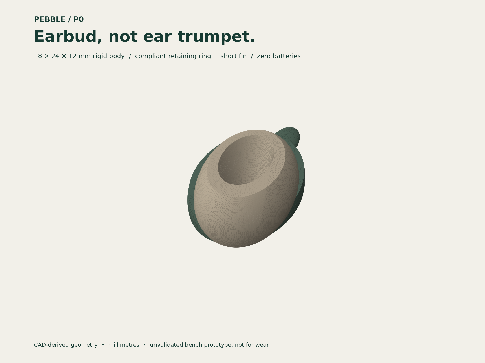
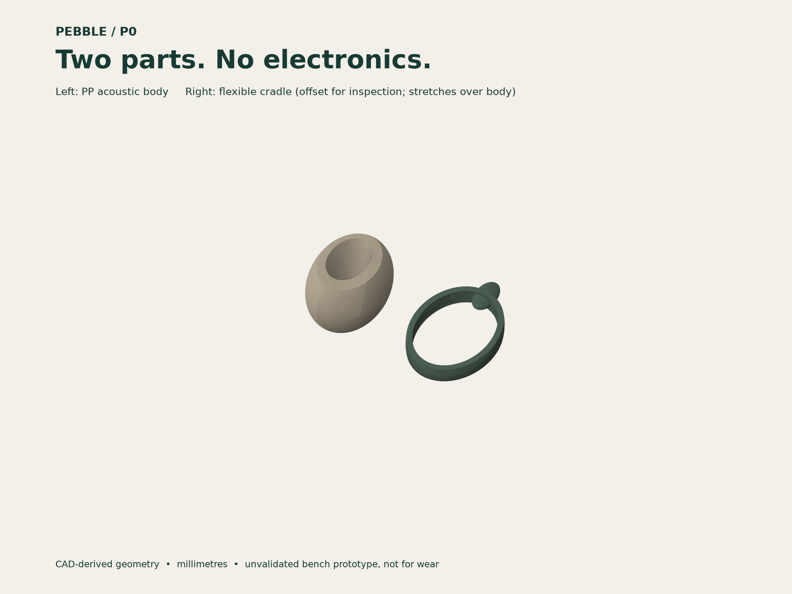
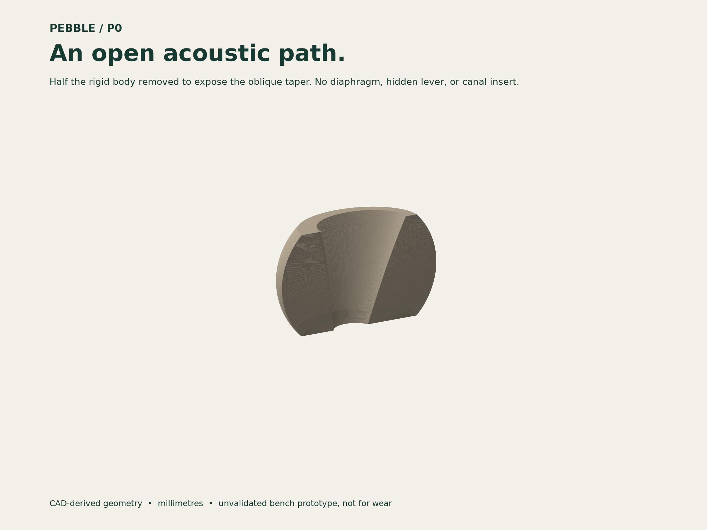
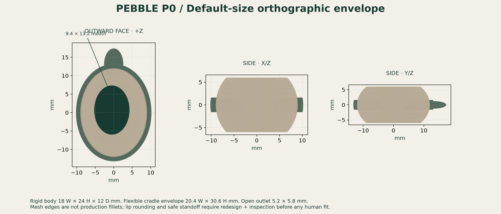
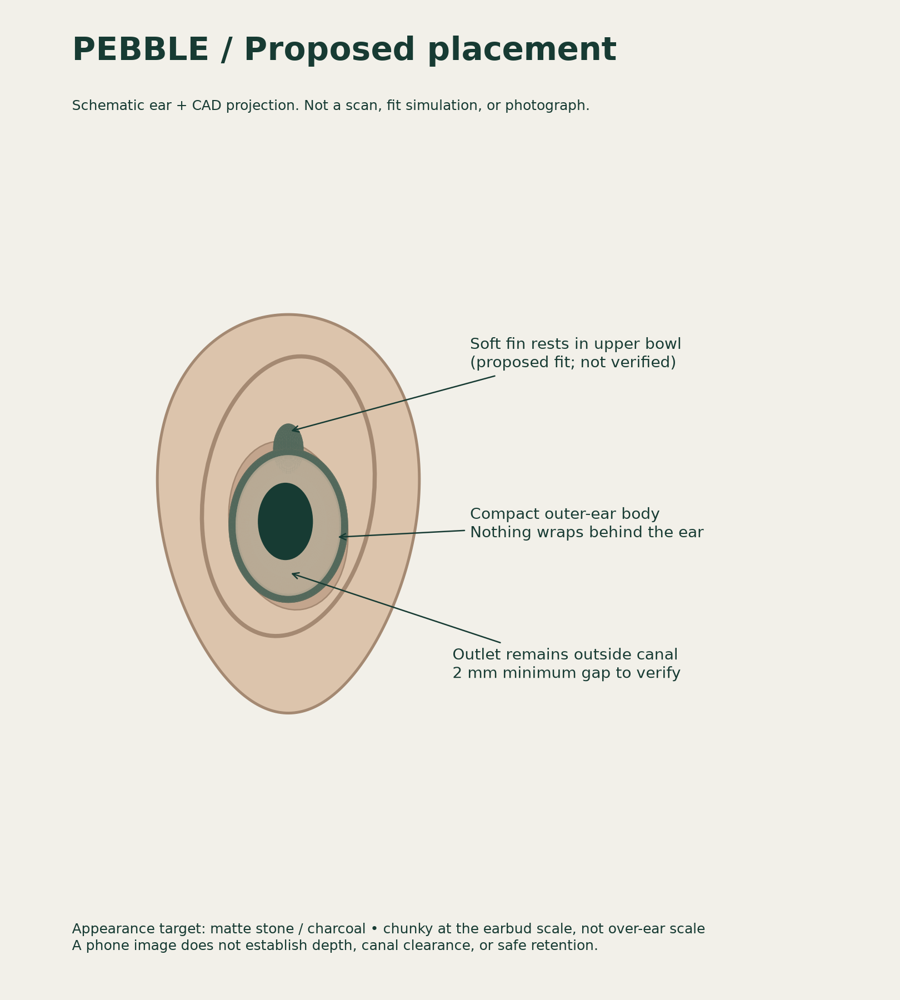

# PEBBLE P0 — independent passive earbud research concept

**Revision:** P0 · 18 October 2026 · Units: mm · Status: BENCH PROTOTYPE ONLY

**This package is not a working, clinically validated hearing aid. Do not wear or insert the supplied printed models.** It provides reproducible CAD, an acoustic hypothesis, sizing software, illustrations, costing assumptions, and a verification plan. No measured amplification, safe fit, clinical benefit, regulatory authorization, waterproofing, or durability is claimed. A compact passive insert can make hearing worse by disturbing the ear's existing acoustic gain.

## 1. Design brief and revision

The first, external scoop concept was rejected. P0 instead uses an earbud-scale rounded body in the concha (the outer-ear bowl), with a short flexible retention fin. Nothing wraps behind the ear. Visual intent: matte stone, charcoal, or individually selected skin-adjacent tones; no bright logos, wires, switches, or long stem. It should feel chunky enough to handle and survive ordinary handling, but remain visually closer to an earbud than a medical appliance. These are design intentions, not tested outcomes.

The reference identified by the user is Amano, developed by McMaster students Arish Shahab, Aaron Yu, and Ramin Syed. McMaster describes a mechanical, customized hearing device [1]. CBC describes earbud styling, photograph-based customization, no electronics, and approximately $20 per pair [2]. Amano's own website lists a $19.99 starting/pre-order price and custom fit from a photo [3]. Prices are attributed reports, not verified quotations or equivalent to a $1 factory cost.

Amano's ResearchGate entry identifies a May 2026 **preprint**, DOI 10.13140/RG.2.2.36677.41444 [4]. Only the listing was accessible in this research; the full PDF, internal dimensions, transfer function, tolerances, raw measurements, and production CAD were not verified. News descriptions about vibration and mechanical advantage are insufficient to reconstruct an internal mechanism. **P0 is not an Amano replica, is not affiliated with Amano, and does not claim Amano performance.** No proprietary images or CAD are included. Commercial development needs an independent IP review; this is not a freedom-to-operate opinion.



## 2. What the human ear actually does

### Outer ear: collection, filtering, resonance

The pinna and concha redirect incident sound and create direction-dependent spectral cues. The canal leads sound to the tympanic membrane. These structures already provide frequency-dependent pressure gain; a device must improve on that **unaided baseline**, not take credit for it [5,6]. The cited real-ear study describes adult canal resonance around 2.7–3 kHz and gains of roughly 10–20 dB, with individual variation [6]. Those figures are anatomy observations, **not P0 gain**.

A simplified canal estimate is `f ≈ c/(4 L_eff)`. Taking c = 343 m/s and L_eff = 0.028 m gives approximately 3,063 Hz. This is a quarter-wave educational approximation, not a model of a tapered, vented device coupled to a particular ear.

### Middle ear: impedance transformation, not free energy

The eardrum moves the malleus, incus, and stapes, transferring vibrations into cochlear fluid [5]. The relatively large effective eardrum area and smaller stapes-footplate area, together with the ossicular lever, provide an impedance transformation [7]. An illustrative area ratio of 17 and lever ratio 1.3 give a pressure ratio near 22 (about 27 dB). Actual middle-ear response is frequency dependent and not this ideal transformer at every frequency [7]. Pressure can increase as displacement/volume velocity changes; acoustic power is not created.

Putting a little lever in an earbud does **not** automatically reproduce this. It needs defined input and output impedances, moving mass, stiffness, damping, a stable suspension, and an acoustic load. A diaphragm requires a pressure difference across it: equal exposure of both sides can cancel its drive. Seal leakage and small output-cavity compliance can eliminate expected pressure gains. P0 therefore does not include an invented diaphragm/lever with an unsupported gain claim.

### Inner ear: active biology cannot be replaced by a plastic funnel

Cochlear traveling waves stimulate sensory hair cells, which convert motion into neural signals [5]. Outer hair cells also help amplify cochlear vibration [8]. This living amplification is not the same as passive outer-ear collection. Passive plastic geometry cannot restore damaged sensory cells or auditory nerves. Electronic hearing aids are useful for many people with sensorineural loss but cannot help every degree of damage [9]. P0 cannot be prescribed for any hearing-loss category without audiological evidence.

### Design consequence

Use the ear's existing canal and middle ear; do not touch the eardrum or enter the canal. First investigate whether a small, open acoustic taper can improve speech-band pressure relative to an unaided ear. If it does not, stop or redesign rather than claim that earbud appearance alone makes it a hearing aid.

## 3. P0 mechanism and geometry

P0 is a two-part, purely passive assembly:

1. **Rigid body:** polypropylene (PP) manufacturing candidate. Rounded pebble envelope surrounding an open, oblique, exponentially widening bore. Sound enters the outward oval mouth, traverses the approximately 12.3 mm centerline path, and leaves at the ear-facing aperture. There are no moving transducers.
2. **Compliant cradle:** TPE or silicone manufacturing candidate, modeled as an elastic collar with a short fin. The collar wraps the rigid body's equator with nominal 0.15 mm radial interference. The fin is intended to engage the upper concha/cymba gently, not clamp the helix. Interference and stiffness require coupon testing; generic TPE is not automatically safe for skin.

Both ends of the sound path are open. There is no inserted nozzle, detachable wax filter, screw, adhesive joint, magnet, battery, microphone, or speaker. The open bore makes visual inspection and rinsing possible, but does not establish an ingress rating. The CAD has no separate bypass vent; the proposed 2 mm minimum outlet-to-canal air gap and surrounding unsealed fit are design requirements that the current photo workflow and geometry **do not enforce**. A real fit must preserve that space; if the body occludes the meatus, it is a failed fit, not a reason to push it inward.

### Default dimensions (illustrative adult fixture)

| Feature | Nominal |
|---|---:|
| Assumed concha height × width | 28 × 22 |
| Rigid body width × height × depth | 18 × 24 × 12 |
| Assembly envelope including fin | 20.4 × 30.6 × 12 |
| Outward mouth width × height | 9.4 × 13.2 |
| Ear-facing outlet width × height | 5.2 × 5.8 |
| Mouth area | 97.45 mm² |
| Outlet area | 23.69 mm² |
| Collar axial thickness | 3.2 |
| Radial collar band beyond body | 1.2 |
| Target outlet/canal air gap | ≥2, **not verified by CAD** |
| Estimated assembled mass | 2.93 g at assumed PP/TPE densities |

Coordinates: X = local lateral direction, Y = superior direction (fin points +Y), +Z = outward face, −Z = toward outer ear. Left CAD mirrors X. Orientation on an individual ear remains a fit decision; the model does not define a registered ear surface. No part is intended to contact the canal.

The body boundary is an elliptical surface with radii `9 sqrt(1-(z/9)^2)` and `12 sqrt(1-(z/9)^2)` for z from −6 to +6. The inner aperture center drifts from (1, −1.3) to (−0.5, 0.7). Aperture radii change exponentially from (2.6, 2.9) to (4.7, 6.6). Python and OpenSCAD expose the construction. The meshes use 128 angular segments and 48 axial intervals; they are engineering concept solids, not a production surface finish specification.

**Edges at the port lips are not filleted in P0.** Before a human-contact revision, add and inspect at least R0.5 mm lip/skin-contact rounding, establish minimum wall thickness, remove burrs and flash, and validate the actual material/contact duration. This unfinished detail alone makes current exports unsuitable for wear.





## 4. Acoustic feasibility: the critical limitation

A small mouth is acoustically small at speech frequencies. At 3 kHz, wavelength is about 114 mm, while the equivalent circular diameter of the mouth is only 11.1 mm (`ka ≈ 0.31`). Strong low-frequency directionality should not be expected. It also sits inside the concha rather than adding a large collecting aperture.

The mouth/outlet area ratio is 4.11. In an **ideal lossless, perfectly coupled, equal-impedance energy-collection thought experiment**, `10 log10(A_mouth/A_outlet)` is about 6.14 dB. This is neither a measured gain nor a reliable upper bound on resonant pressure. Do not apply `20 log10(area ratio)` as a product gain or add either estimate to the ear's natural gain.

A quarter-wave heuristic for the 12.3 mm duct gives about **7.0 kHz**, not the 2–4 kHz speech region. This bore has two open ends and a complex ear load, so even that heuristic does not predict its actual resonances. This warns against pretending that the present geometry is speech-tuned. Occlusion, leakage, aperture radiation impedance, viscothermal losses, and concha displacement may dominate. **Net insertion gain could be zero or negative.**

P0 is consequently a manufacturable-form/acoustic baseline to test, not a demonstrated solution to hearing loss. A folded 25–35 mm path or a diaphragm cartridge could be a later research branch, but neither is included or claimed to work. A folded path adds cleaning and loss concerns; a diaphragm adds fragility, assembly tolerance, and humidity sensitivity. First compare P0 against both the unaided fixture and an equally shaped body with a straight hole. No simulated gain curves are supplied because no defensible acoustic simulation has been run.

Meaningful measurement is `IG(f) = 20 log10(|p_device(f)| / |p_unaided(f)|)` at the **same ear-simulator microphone, source, and level**. Clinical real-ear insertion gain likewise subtracts the unaided response from the aided response [10]. Mouth-to-outlet gain alone is not proof of benefit.

## 5. Phone-assisted customization

`phone/index.html` is a functional local-browser manual landmark tool. It does not use AI, cloud inference, external scripts, or a server-side upload. A local photo remains in browser memory; only dimensions are downloaded. Metadata are not intentionally exported. Clear the page when finished; ordinary browser/device privacy still applies.

1. Ask a helper to photograph the ear side-on, rear camera, diffuse light, about 40–60 cm away. Keep hair clear. Never put a ruler or phone inside the ear.
2. Place a measured 20 mm paper reference beside the ear in the **same plane** as the concha. The scale must span at least 50 pixels in the displayed internal image. A ruler elsewhere on the head gives an incorrect scale.
3. Mark reference endpoints, concha top/bottom, and concha left/right: six points. Do not use total pinna dimensions.
4. Capture a second independent photograph. Repeat measurement; require both dimensions to agree within 1 mm. The tool asks for a human confirmation; it does not compare or validate the second image automatically.
5. Export `fit.json`. The source image and landmark coordinates are not included in that file.
6. Run the CAD builder with that file. Body H = concha H − 4; body W = concha W − 4. This gives nominal 2 mm clearance per side for the **rigid body only**, not an anatomical guarantee. The compliant fin intentionally extends beyond that envelope.
7. Review a non-wear fixture model. A clinician-led fit process, depth measurement, retention study, and ear-surface registration are still needed for any later human-contact model.

The accepted adult design window, H 24–32 and W 19–25 mm, is an **arbitrary provisional engineering guardrail**, not an anthropometrically validated population range. Outside it, the script refuses to scale. X/Y dimensions of the bore also scale, changing acoustic behavior; depth remains 12 mm. Each size needs acoustic verification. Neither an image nor this mapping recovers hidden canal depth, undercuts, tissue compliance, or a personalized safe insertion surface. There is no canal-design mode.

Measurement error is important: with a 20 mm reference spanning 200 px, a 2 px error at each endpoint is already roughly 0.4 mm worst-case reference-length error (2%). Perspective and plane mismatch can be larger. Calibration and repeatability are essential. This is photo-assisted size selection, **not automatic exact custom fitting**.



## 6. Materials, manufacturing, assembly, durability

### Bench prototypes

Print the rigid body in an accessible rigid material and the cradle in TPU only for fixture testing. PLA/PETG and generic TPU are not endorsed for skin contact. Do not use uncured resin or sharp/porous FDM parts on people. The body has a through-bore with no sealed internal support cavity; orient the wide mouth upward (+Z) and inspect support strategy in a slicer. Use a 0.4 mm nozzle / approximately 0.15–0.2 mm layers as a starting point, not a validated process. Print cradle flat. Keep supports out of the acoustic passage. Verify open apertures with inspection, not just a slicer preview. Prototype price is not $1.

For fixture assembly, stretch the compliant collar over the body until centered at z=0; the fin points +Y. There is no positive mechanical lock in P0. Slippage, creep, and fin pullout are open risks. A production revision may need a retaining groove, but that groove is not in the supplied CAD. Do not glue these parts and call the joint validated.

### Production candidates

PP body with contact-appropriate, documented pigments; TPE cradle with selected durometer (initial screening 45–65 Shore A) or liquid silicone. Material supplier documentation, irritation/sensitization assessment, cleaning compatibility, and finished-device biological evaluation must precede human use. “Food safe” is not a substitute. Consider ISO 10993-1 within a qualified biological evaluation plan and ISO 14971 risk management; no compliance claim is made.

The continuous tapered bore can potentially use a removable axial core because its projected sections expand toward +Z, but the body bulges and has undrafted end details. Toolmaker review must resolve parting line, draw direction, bore-core withdrawal, flash, shrinkage, and ejection. Mesh CAD is not tool-ready. Thick walls may sink or warp; a shell-thinning/DFM revision is needed. Set draft and shrink compensation from supplier data, not a universal number.

Initial drawing targets to investigate: ports ±0.15 mm; external dimensions ±0.25 mm; collar interference 0.15 ±0.10 mm; skin-contact/lip R≥0.5 mm; no visible flash or loose particles. These are proposed inspection requirements, **not achieved measurements**. Minimum wall has not been certified; perform section and thickness analysis after filleting. Do not infer strength from watertight mesh tests.

### Proposed durability qualification (none performed)

- Ten 1.5 m drops onto a defined hard surface in varied orientations; no cracks, splinters, loose pieces, or meaningful acoustic change.
- 1,000 collar assembly/removal cycles and 5,000 fin deflections on a fixture; inspect tearing, permanent set, and attachment slip.
- Synthetic sweat, UV, and 40 °C/high-humidity exposure with specified dwell times; evaluate dimensional change, odor, tack, discoloration, and acoustic drift.
- 100 validated cleaning cycles; no swelling or residue; record before/after IG. Suggested acoustic drift gate: ≤2 dB from 1–4 kHz after refit, subject to measurement uncertainty.
- Pull/slip characterization on a fixture before establishing any wear retention target. Avoid excessive retention that could injure an ear during snagging.

Do not boil, solvent-clean, or promise dishwasher/waterproof performance. A candidate care routine is mild soap, warm water, rinse and full air-dry; it must be verified for the actual material and hygiene requirements before becoming an instruction for use. No claimed service life.

## 7. $1 economics — per single device, not pair

The original request did not specify currency or per ear versus pair. This package assumes **US$1 factory manufacturing cost per ear** at 100,000 units, standard size family, not US$1 retail/custom delivered. This is a transparent target budget, not a supplier quote.

| Cost element | Assumed US$/unit |
|---|---:|
| PP resin, pigment, waste allowance | 0.02 |
| TPE resin and waste allowance | 0.02 |
| Body molding conversion | 0.10 |
| Cradle molding conversion | 0.10 |
| Assembly and visual inspection | 0.10 |
| Allocated batch acoustic QC | 0.08 |
| Simple paper pack | 0.05 |
| Rejects/overhead allowance | 0.08 |
| Tool amortization: $15,000 / 100,000 | 0.15 |
| **Illustrative total** | **0.80** |
| Headroom to $1 target | 0.20 |

Tooling cost and all conversion figures are assumptions with no vendor validation. At 10,000 units, the same $15,000 tooling alone adds $1.50/unit, giving about $2.15 on this simplistic model. At 1,000, it becomes about $15.65. The resin subtotal is not the total manufacturing cost.

Excluded: R&D, acoustic simulation, clinical studies, regulatory work, individual scan review, per-unit custom tooling/printing, freight, duty/VAT, distribution, fitting, warranty, margin, and replacement costs. The estimated 2.93 g mass is calculated from CAD volume and assumed densities (0.90 g/cm³ PP, 1.10 TPE), not a weighed sample.

**Individually unique 3D printing and the $1 target have not been reconciled.** For a mass-production route, photo dimensions could select among qualified size families; current software generates a continuously scaled, individually unique model instead. Do not conflate the two. A custom-print service needs real quotations and a separate cost model. A $1 retail price, a $1 pair, and a $1 fully customized delivered device are not established here.

## 8. Verification, stop/go gates, and safety

### Gate A — CAD and bench inspection

Automated tests check watertight, positive-volume, single-body meshes; left/right mirroring; default envelope; open-bore sampled containment; guardrails; and that fixture exports build. They do not establish biocompatibility, edge safety, moldability, mechanical strength, or hearing improvement. Minimum wall clearance sampling is not a certified shortest-distance thickness result.

### Gate B — calibrated acoustics before any human trial

Use a calibrated ear simulator/manikin with pinna and consistent ear-canal reference microphone, not a phone microphone/AGC. Measure source level with an independent reference microphone; keep source 1 m away in a controlled acoustic space. Measure 250 Hz–8 kHz at 55, 65, and 75 dB SPL, front/±45°/±90°/rear incidence, unaided vs fitted vs control. Repeat at least five removals/refits per condition, with recorded gap (0/2/4 mm) on the fixture and candidate sizes. Report frequency-resolved mean, uncertainty, worst-fit response, directivity, and source spectrum.

Proposed research go/no-go gate: positive speech-band insertion gain averaging at least 3 dB over 1–4 kHz at front incidence, confidence interval above zero; no attenuation deeper than 5 dB over any contiguous one-third-octave band in that region; investigate any narrow peak above 10 dB. These are **internal screening proposals**, not clinical standards or a safe-output limit. A compact passive device may fail this gate. Log failed designs honestly.

A linear passive device has no electronic compression, volume control, or calibrated peak limiter. It can concentrate loud noise as well as speech. It is not hearing protection. Testing at conversation levels does not prove safety in traffic, concerts, or machinery noise.

### Gate C — mechanical, material, and regulatory work

Complete durability and cleaning tests; address edge radii, retention failure, fit depth, and material risks; commission qualified biological evaluation and jurisdiction-specific regulatory review. Intended use and claims determine classification. Do not extrapolate Amano's reported licensing or classification to P0, Zimbabwe, or another market.

### Gate D — supervised human research, only after the above

Qualified audiology/ENT review, consent and ethics requirements, otoscopy, audiogram, probe-microphone verification, objective speech testing in quiet/noise, comfort/pressure evaluation, retention with jaw motion and glasses, and long-term hygiene assessment. No home testing by inserting a print. Sudden hearing loss needs urgent medical assessment [11]. Pain, drainage, dizziness, or unilateral symptoms warrant professional assessment rather than self-treatment. Not a pediatric design; small parts are a choking risk. No benefit claim for severe hearing loss, no cure claim, and no substitution for medical care.

## 9. Deliverables and reproducibility

- `cad/pebble.scad`: native editable OpenSCAD model; select assembly/shell/cradle/exploded/section and enter concha dimensions/side.
- `cad/shell.stl`, `cad/cradle.stl`: separate millimetre fixture solids; use both, not the cutaway, for assembly.
- `cad/shell-section.stl`: explanatory cutaway only.
- `cad/build-report.json`: dimensions, volumes, mass estimate, mesh checks, and limitations.
- `tools/build.py`: authoritative parametric mesh builder; `tools/render.py`: figures from exported geometry; `tools/booklet.py`: PDF builder.
- `phone/index.html`: local photo-sizing tool; downloaded JSON feeds the builder.
- `tests/test_design.py`: reproducible geometric/regression checks.
- `docs/PEBBLE-P0.pdf`: illustrated design dossier generated from this document.

Use Python 3.11+ and the pinned dependencies in `requirements.txt`. No CadQuery, GPU, or online CAD account required. OpenSCAD is optional for native editing. The Python-generated meshes and reports were executed and tested; the OpenSCAD source is an editable companion and was not independently rendered in this environment. It approximates the collar fin with a different sphere tessellation and includes 0.001 mm slice overlaps; do not expect byte-identical meshes. No STEP file or production tooling CAD is claimed.

```sh
python -m venv .venv
.venv/bin/pip install -r passive-ear/requirements.txt
.venv/bin/python passive-ear/tools/build.py
.venv/bin/python passive-ear/tools/render.py
.venv/bin/python -m unittest discover -s passive-ear/tests -v
.venv/bin/python passive-ear/tools/booklet.py
# With dimensions exported by the phone tool:
.venv/bin/python passive-ear/tools/build.py --fit /path/to/fit.json --output /path/to/custom-cad
# Serve documents + photo tool (bind for Arena preview):
.venv/bin/python -m http.server 8080 --bind 0.0.0.0 --directory passive-ear
```

The default JSON is illustrative, not a real person's scan. Never publish patient photos or identifiable measurements in Git without consent. This repository contains no patient images. The placement illustration is a schematic, not an anatomical fit simulation. Every product view is derived from the included mesh, not an AI photograph.

## 10. Sources and evidence limits

Accessed 18 October 2026. Marketing statements are attributed, not independently verified. No physical device, clinical trial, mold quotation, FEM/BEM model, or human scan was available to this work.

[1] McMaster University. *From the classroom to California: McMaster students launch hearing care startup Amano.* https://news.mcmaster.ca/mcmaster-students-launch-hearing-care-startup-amano/

[2] CBC. *Meet 3 McMaster University students who created hearing aids that could cost $20 a pair.* https://www.cbc.ca/news/canada/hamilton/mcmaster-students-affordable-hearing-aids-9.7259207

[3] Amano. Product/pre-order website. https://www.amanolabs.com/

[4] Shahab, A. *Amano: AI-Driven Parametric Design of Passive Acoustic Hearing Devices for Low-Resource Settings.* Preprint listing, May 2026; full text not verified. https://www.researchgate.net/publication/404419197_Amano_AI-Driven_Parametric_Design_of_Passive_Acoustic_Hearing_Devices_for_Low-Resource_Settings

[5] NIDCD. *How Do We Hear?* https://www.nidcd.nih.gov/health/how-do-we-hear

[6] *Real ear unaided gain and its relation with the equivalent volume of the external and middle ear.* https://pmc.ncbi.nlm.nih.gov/articles/PMC4432547/

[7] *Anatomy and Physiology of Hearing.* Middle-ear impedance-matching discussion. https://entokey.com/anatomy-and-physiology-of-hearing/

[8] NIDCD. *Auditory Neuropathy.* Outer/inner hair-cell roles. https://www.nidcd.nih.gov/health/auditory-neuropathy

[9] NIDCD. *Hearing Aids.* https://www.nidcd.nih.gov/health/hearing-aids

[10] Interacoustics. *Aided Response or Insertion Gain?* https://www.interacoustics.com/blog/aided-response-or-insertion-gain

[11] NIDCD. *Sudden Deafness.* https://www.nidcd.nih.gov/health/sudden-deafness
